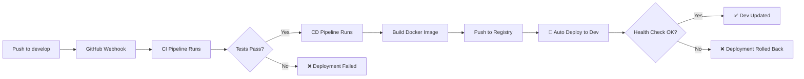
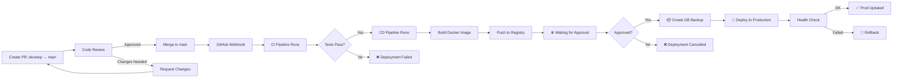

# Deployment Checklist & Runbook

Panduan lengkap untuk deployment ProjectFlow backend.

---

## 📋 Pre-Deployment Checklist

### 1. Code Quality ✅

- [ ] Code review approved
- [ ] All tests passing
- [ ] No security vulnerabilities
- [ ] Code formatted correctly
- [ ] No console errors/warnings
- [ ] Commit message is clear

```bash
# Verify locally
docker-compose up -d
go test ./...
go vet ./...
docker-compose down -v
```

### 2. Git Preparation ✅

- [ ] Latest code from develop
- [ ] Branch is up to date with main (for releases)
- [ ] No uncommitted changes
- [ ] Commit history is clean

```bash
git status
git log --oneline -5
```

### 3. Environment Preparation ✅

**For Development:**
- [ ] .env file updated
- [ ] All required secrets configured
- [ ] Database migrations prepared
- [ ] Redis connection verified

**For Production:**
- [ ] Secrets are in Jenkins/deployment server
- [ ] Database backup verified
- [ ] Load balancer configured
- [ ] DNS/SSL certificates ready
- [ ] Monitoring alerts configured

### 4. Deployment Server Readiness ✅

```bash
# SSH ke deployment server
ssh deployer@deployment-server

# Check disk space
df -h

# Check docker
docker --version
docker-compose --version

# Check existing containers
docker-compose ps

# Check backups directory exists
ls -la /backups/projectflow/
```

### 5. Jenkins Readiness ✅

- [ ] Jenkins server running
- [ ] All credentials configured
- [ ] GitHub webhook working
- [ ] Build agents available
- [ ] Executor slots available

```bash
# Test Jenkins connectivity
curl -I https://jenkins.example.com/
```

---

## 🚀 Deployment Process

### Scenario 1: Development Deployment (Automatic)



**Time:** ~20-30 minutes total

**Steps:**
1. Push code to `develop` branch
2. GitHub triggers webhook
3. Jenkins CI runs automatically
4. Jenkins CD runs automatically
5. API auto-deploys to dev server
6. Health checks verify deployment

### Scenario 2: Production Deployment (Manual Approval)



**Time:** ~30-45 minutes + approval time

**Steps:**
1. Create feature branches from `develop`
2. Push code & create PR
3. Code review & approval
4. Merge to `develop` (auto-deploy to dev)
5. When ready, create PR: `develop` → `main`
6. Merge to `main` (requires merge commit)
7. GitHub triggers webhook
8. Jenkins CI runs
9. Jenkins CD builds image & waits for approval
10. Go to Jenkins, review, click "Proceed"
11. CD deploys with backup & health checks

---

## ✅ Manual Approval Steps

### Step 1: Open Jenkins

Navigate to: `https://jenkins.example.com/`

### Step 2: Find CD Pipeline Build

1. Click on `projectflow-backend-cd`
2. Find latest build for `main` branch
3. Click build number (e.g., #152)

### Step 3: Review Deployment Info

Dialog will show:
```
PRODUCTION DEPLOYMENT APPROVAL

Image: docker-username/projectflow-api:152
Commit: abc1234
Author: Your Name
Message: Release v1.0.0
```

### Step 4: Decision

- **Click "Deploy to Production"** → Proceed with deployment
- **Click "Abort"** → Cancel deployment

### Step 5: Monitor Deployment

1. Watch console output in real-time
2. Monitor stages:
   - Checkout
   - Build Image
   - Push to Registry
   - Create DB Backup
   - Deploy to Production
   - Health Check

### Step 6: Verify Production

```bash
# SSH ke production server
ssh deployer@prod-server

# Check services
docker-compose ps

# Check logs
docker-compose logs -f api

# Test API
curl https://api.example.com/health
```

---

## 🔄 Rollback Procedures

### Scenario 1: Immediate Rollback (within minutes)

```bash
# SSH ke deployment server
ssh deployer@deployment-server

# Stop current version
docker-compose down

# Use previous image
export DOCKER_IMAGE=docker-username/projectflow-api:151  # Previous build

# Start with previous version
docker-compose up -d

# Verify
curl http://localhost:4000/health
```

### Scenario 2: Database Rollback (if data corrupted)

```bash
# SSH ke deployment server
ssh deployer@deployment-server

# Stop services
docker-compose down

# Find available backup
ls -lh /backups/projectflow/

# Restore from backup
gunzip -c /backups/projectflow/db_backup_YYYYMMDD_HHMMSS.sql.gz | \
  docker-compose exec -T postgres psql -U projectflow projectflow

# Restart services
docker-compose up -d

# Verify
docker-compose logs -f api
```

### Scenario 3: Partial Rollback (API only)

```bash
# Update image in .env
APP_IMAGE=docker-username/projectflow-api:151

# Restart API
docker-compose up -d api

# Verify health
curl http://localhost:4000/health
```

### Scenario 4: Emergency Kill Switch

```bash
# Stop all services immediately
docker-compose down

# Wait for manual investigation
# Then redeploy with latest stable version

docker-compose up -d
```

---

## 📊 Post-Deployment Verification

### Immediate Checks (0-5 minutes)

```bash
# ✅ Services running
docker-compose ps

# ✅ API responding
curl http://localhost:4000/health

# ✅ Database accessible
docker-compose exec postgres pg_isready -U projectflow

# ✅ Redis working
docker-compose exec redis redis-cli ping

# ✅ No errors in logs
docker-compose logs api | grep -i error
```

### Application Checks (5-15 minutes)

```bash
# ✅ API endpoints working
curl http://localhost:4000/api/v1/projects

# ✅ Authentication working
curl -X POST http://localhost:4000/api/v1/auth/login \
  -H "Content-Type: application/json" \
  -d '{"email":"user@example.com","password":"password"}'

# ✅ Database queries working
# Check application logs for any SQL errors
docker-compose logs api | grep -i "error\|exception"
```

### Infrastructure Checks (15-30 minutes)

```bash
# ✅ Memory usage normal
docker stats --no-stream

# ✅ Disk space available
df -h

# ✅ No service restarts
docker-compose logs | grep "Restart"

# ✅ Network connectivity
docker-compose exec api ping redis
```

### Monitoring Checks (30+ minutes)

- [ ] Error rate within normal range
- [ ] Response time normal
- [ ] Database connections healthy
- [ ] No unusual logs
- [ ] Traffic flowing normally
- [ ] Alerts not triggered

---

## 🚨 Incident Response

### If Deployment Fails

#### Step 1: Stop the bleeding
```bash
# Kill current deployment
docker-compose down

# Restore previous version
export DOCKER_IMAGE=previous-build
docker-compose up -d
```

#### Step 2: Investigate
```bash
# Check logs
docker-compose logs api > /tmp/error.log

# Check system resources
docker stats

# Check database
docker-compose exec postgres pg_isready
docker-compose logs postgres
```

#### Step 3: Notify Team
- Slack: `#deployments` channel
- Email: `devops-team@example.com`
- Include: error logs, timeline, status

#### Step 4: Document
```bash
# Create incident report
cat > /tmp/incident-2024-01-15.txt << EOF
Incident Time: 2024-01-15 10:30 UTC
Deployment: projectflow-api:152
Status: ROLLBACK
Root Cause: Database migration timeout
Resolution: Reverted to build 151
Duration: 15 minutes
EOF
```

### If Performance Degrades

```bash
# Check resource usage
docker stats

# Check slow queries
docker-compose exec postgres psql -U projectflow -d projectflow -c \
  "SELECT query FROM pg_stat_statements ORDER BY total_time DESC LIMIT 10;"

# Check connections
docker-compose exec postgres psql -U projectflow -d projectflow -c \
  "SELECT usename, count(*) FROM pg_stat_activity GROUP BY usename;"

# Potential fixes
# 1. Increase cache (Redis)
# 2. Scale database connections
# 3. Add database indexes
# 4. Rollback if query changed
```

### If Database Corrupted

```bash
# Quick restore from last backup
/opt/projectflow/backend/scripts/restore-db.sh \
  /backups/projectflow/db_backup_latest.sql.gz

# Verify data integrity
docker-compose exec postgres psql -U projectflow -d projectflow \
  "SELECT COUNT(*) FROM projects;"
```

---

## 📝 Deployment Log Template

Save setiap deployment dengan template ini:

```
=================================================
DEPLOYMENT LOG
=================================================

Date: YYYY-MM-DD
Time: HH:MM UTC
Environment: production
Build Number: ###
Commit Hash: abc1234
Author: Your Name

DEPLOYMENT STEPS
================
[ ] Code merged to main
[ ] CI Pipeline completed
[ ] CD Pipeline completed
[ ] Manual approval done
[ ] Database backup created
[ ] Services deployed
[ ] Health checks passed

VERIFICATION
============
[ ] API responding
[ ] Database connected
[ ] Redis connected
[ ] Logs clean
[ ] No errors

PERFORMANCE
===========
API Response Time: XXms
Error Rate: 0.01%
Memory Usage: XX%
CPU Usage: XX%

ROLLBACK PLAN
=============
Previous Build: ###
Backup File: db_backup_YYYYMMDD_HHMMSS.sql.gz
Estimated Time: 5 minutes

NOTES
=====
[Any issues or notes]

Deployed By: [Your Name]
Status: ✅ SUCCESS
=================================================
```

---

## 🔐 Security Considerations

### Before Every Deployment

- [ ] Code review completed
- [ ] Security scan passed
- [ ] No sensitive data in code
- [ ] Secrets stored in Jenkins
- [ ] SSH keys secured
- [ ] Database credentials updated (if changed)

### After Every Deployment

- [ ] Verify HTTPS is working
- [ ] Check firewall rules
- [ ] Verify authentication working
- [ ] Monitor for suspicious activity
- [ ] Check access logs
- [ ] Verify backups created

---

## 📞 Contacts

**On-Call DevOps:** devops-oncall@example.com  
**Slack Channel:** #deployments  
**Escalation:** Lead DevOps Engineer  
**Emergency:** Use `/emergency-page` command in Slack

---

## ✨ Quick Reference

| Action | Command |
|--------|---------|
| View logs | `docker-compose logs -f api` |
| Check health | `curl http://localhost:4000/health` |
| Restart API | `docker-compose restart api` |
| View status | `docker-compose ps` |
| Emergency stop | `docker-compose down` |
| Database backup | `scripts/backup-db.sh` |
| Database restore | `scripts/restore-db.sh <file>` |
| View backups | `ls -lh /backups/projectflow/` |

---

**Last Updated:** 2024  
**Version:** 1.0.0
