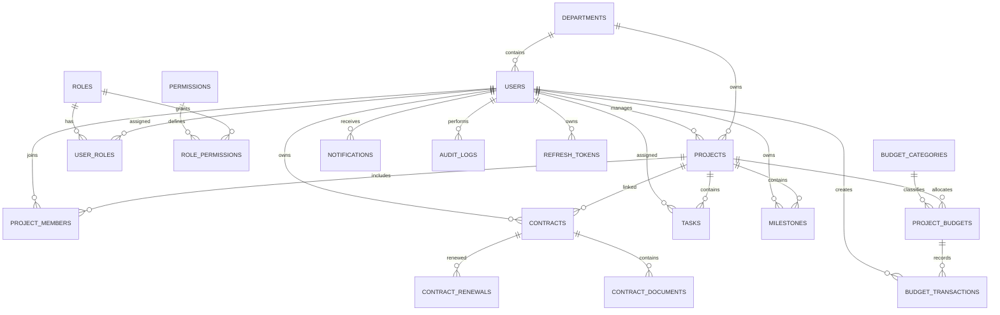

# BACKEND PRD
# ProjectFlow – Project & Contract Management System

**Document Type:** Product Requirements Document  
**Product:** ProjectFlow  
**Component:** Backend API  
**Version:** 1.0  
**Scope:** MVP  
**Technology:** Go, Gin, PostgreSQL  
**Architecture:** REST API / Clean Architecture

---

## 1. Product Overview

### 1.1 Background

ProjectFlow is an enterprise Project & Contract Management System designed to solve three recurring business problems:

1. Contract expiration dates are frequently overlooked.
2. Project timelines are delayed due to insufficient monitoring.
3. Project budgets are not monitored effectively against actual expenditures.

The backend provides centralized business logic, data management, authentication, authorization, automated monitoring, and reporting capabilities.

### 1.2 Objectives

The backend must:

- Provide secure REST APIs.
- Maintain centralized project and contract records.
- Monitor contract expiration automatically.
- Track project tasks and milestones.
- Monitor approved budgets, committed costs, and actual expenditures.
- Generate notifications for critical events.
- Maintain an auditable record of important activities.
- Provide aggregated data for management dashboards.

### 1.3 Target Users

| User Role | Backend Access |
|---|---|
| Super Admin | Full system access |
| Admin | User, department, and system administration |
| Executive | Dashboard and reporting |
| Project Manager | Project, tasks, milestones, budget visibility |
| Project Member | Assigned tasks and project updates |
| Finance | Budget and financial transactions |
| Contract Manager | Contract registration and renewal tracking |
| Viewer | Read-only access |

Authorization must be enforced at the API level, not merely through frontend visibility.

---

## 2. Technology Stack

| Component | Technology |
|---|---|
| Language | Go |
| Framework | Gin |
| ORM | GORM |
| Database | PostgreSQL |
| Migration | golang-migrate |
| Authentication | JWT |
| Password Hashing | Argon2id or bcrypt |
| Validation | go-playground/validator |
| Logging | Uber Zap |
| Background Jobs | Asynq + Redis |
| Documentation | Swagger / OpenAPI |
| Testing | Go testing + Testify |
| Container | Docker |
| API Format | JSON |

Use stable, compatible dependencies and lock dependency versions.

---

## 3. Backend Architecture

Use Clean Architecture with modular domain boundaries.

### 3.1 Directory Structure

```text
projectflow-backend/
├── cmd/
│   └── api/
│       └── main.go
│
├── internal/
│   ├── config/
│   ├── database/
│   ├── domain/
│   │   ├── auth/
│   │   ├── user/
│   │   ├── organization/
│   │   ├── project/
│   │   ├── contract/
│   │   ├── task/
│   │   ├── milestone/
│   │   ├── budget/
│   │   ├── notification/
│   │   └── audit/
│   │
│   ├── handler/
│   ├── middleware/
│   ├── repository/
│   ├── service/
│   ├── dto/
│   ├── scheduler/
│   ├── worker/
│   ├── validator/
│   └── pkg/
│
├── migrations/
├── docs/
├── scripts/
├── tests/
├── Dockerfile
├── docker-compose.yml
├── Makefile
├── go.mod
├── go.sum
└── README.md
```

### 3.2 Architectural Principles

- Handler: HTTP request and response handling.
- Service: Business logic and validation.
- Repository: Database operations.
- Domain: Core business entities and rules.
- Middleware: Authentication, authorization, logging, and request handling.
- Worker: Asynchronous background processing.
- Scheduler: Periodic monitoring jobs.

Avoid putting business logic inside HTTP handlers.

Use dependency injection and interface-based boundaries where they provide practical value.

---

## 4. Functional Requirements

### 4.1 Authentication & Authorization

**Priority:** Critical

Features:

- Login.
- Logout.
- Refresh token.
- Get authenticated user profile.
- User management.
- Role management.
- Permission checking.
- Password hashing.
- Account activation/deactivation.

Business rules:

1. Users must authenticate before accessing protected endpoints.
2. Passwords must never be stored in plaintext.
3. Access tokens must have configurable expiration.
4. Refresh tokens must support revocation and rotation.
5. Inactive users cannot authenticate.
6. Backend authorization must verify user permissions.
7. Sensitive authentication data must not be written to application logs.

Initial roles:

- SUPER_ADMIN
- ADMIN
- EXECUTIVE
- PROJECT_MANAGER
- PROJECT_MEMBER
- FINANCE
- CONTRACT_MANAGER
- VIEWER

Use role-based permissions with resource-level ownership checks where appropriate.

### 4.2 Organization Management

**Priority:** High

Features:

- Create department.
- Update department.
- List departments.
- Activate/deactivate department.
- Assign users to departments.

Department attributes:

- ID
- Code
- Name
- Description
- Is Active
- Created At
- Updated At

### 4.3 Project Management

**Priority:** Critical

Project attributes:

- ID
- Project Code
- Project Name
- Description
- Category
- Department ID
- Project Owner ID
- Project Manager ID
- Start Date
- Target End Date
- Actual Start Date
- Actual End Date
- Approved Budget
- Currency
- Priority
- Status
- Progress
- Created At
- Updated At

Project statuses:

- DRAFT
- PROPOSED
- PLANNING
- APPROVED
- IN_PROGRESS
- ON_HOLD
- COMPLETED
- CANCELLED

Features:

- Create project.
- Update project.
- List projects.
- View project details.
- Archive project.
- Assign project manager.
- Assign team members.
- Update project progress.
- Filter by status and department.
- Search by project name and code.

Project code generation:

`YEAR-OWNER-CATEGORY-RUNNING_NUMBER`

Example:

`2026-AHA-RKAP-001`

The code generation mechanism must be configurable and concurrency-safe.

### 4.4 Contract Management

**Priority:** Critical

Contract attributes:

- ID
- Contract Number
- Contract Name
- Contract Type
- Vendor Name
- Contract Owner ID
- Department ID
- Related Project ID
- Start Date
- Effective Date
- End Date
- Contract Value
- Currency
- Renewal Type
- Renewal Notice Period
- Status
- Description
- Created At
- Updated At

Contract statuses:

- DRAFT
- UNDER_REVIEW
- ACTIVE
- EXPIRING_SOON
- RENEWAL_IN_PROGRESS
- EXPIRED
- TERMINATED
- COMPLETED

Features:

- Create contract.
- Update contract.
- View contract details.
- List contracts.
- Search contracts.
- Filter by status.
- Filter by department.
- Filter by owner.
- Filter by expiration period.
- Upload contract documents.
- View contract history.
- Register renewal records.
- Link contracts to projects.

#### Contract Expiration Rules

The system must calculate expiration status based on the contract end date.

| Remaining Days | Classification |
|---|---|
| More than 90 days | Normal |
| 60–90 days | Early Warning |
| 30–59 days | Warning |
| 14–29 days | High Priority |
| 1–13 days | Critical |
| 0 or less | Expired |

Reminder schedule:

- H-90
- H-60
- H-30
- H-14
- H-7
- Expiration date

Business rules:

1. Contract owner must be assigned.
2. End date must not be earlier than start date.
3. Contract value must be non-negative.
4. Reminder jobs must not generate duplicate notifications.
5. Renewal must preserve the original contract record.
6. A renewal must be linked to its previous contract.
7. Expired contracts must remain available for historical reporting.
8. Terminated contracts must not be treated as active contracts.
9. Expiration monitoring must use the configured business timezone.

### 4.5 Task Management

**Priority:** Critical

Task attributes:

- ID
- Project ID
- Parent Task ID
- Title
- Description
- Assigned User ID
- Priority
- Status
- Planned Start Date
- Planned Due Date
- Actual Start Date
- Actual Completion Date
- Progress
- Created At
- Updated At

Task statuses:

- BACKLOG
- TODO
- IN_PROGRESS
- IN_REVIEW
- BLOCKED
- DONE
- CANCELLED

Features:

- Create tasks.
- Update tasks.
- Assign tasks.
- Update task status.
- Update progress.
- Filter tasks by status.
- List tasks by project.
- List tasks assigned to the current user.
- Retrieve overdue tasks.

Business rules:

- Due date cannot precede start date.
- Progress must be between 0 and 100.
- Completing a task sets its progress to 100%.
- A task marked overdue must be identified automatically.
- Only authorized users can modify tasks.
- Actual dates must be maintained when work starts or finishes.

### 4.6 Milestone Management

**Priority:** Critical

Milestone attributes:

- ID
- Project ID
- Name
- Description
- Planned Date
- Actual Date
- Status
- Owner ID
- Created At
- Updated At

Statuses:

- PENDING
- IN_PROGRESS
- COMPLETED
- DELAYED

Features:

- Create milestone.
- Update milestone.
- List milestones.
- Mark milestone as completed.
- Calculate schedule delay.
- Identify upcoming milestones.

Business rules:

- A milestone must belong to one project.
- Delayed milestones must be visible to Project Managers.
- Actual completion dates must be retained.
- Changes to milestone dates must be recorded in audit logs.

### 4.7 Budget Management

**Priority:** Critical

Budget components:

- Approved Budget.
- Planned Budget.
- Committed Cost.
- Actual Cost.
- Remaining Budget.
- Budget Variance.
- Utilization Percentage.

Budget categories:

- PERSONNEL
- INFRASTRUCTURE
- SOFTWARE_LICENSE
- PROCUREMENT
- VENDOR_CONSULTANT
- OPERATIONAL
- OTHER

Features:

- Register approved project budget.
- Allocate budget by category.
- Register committed cost.
- Record actual expenditure.
- View budget summary.
- List financial transactions.
- Filter transactions by category and date.
- View budget utilization.

Business rules:

1. Approved budget must be non-negative.
2. Monetary values must use PostgreSQL NUMERIC.
3. Transactions must be associated with an existing project.
4. Financial records must not be silently overwritten.
5. Financial corrections must be traceable.
6. Budget threshold alerts must be configurable.
7. Financial records must have an owner and transaction date.

Budget calculation:

```text
Actual Cost =
SUM(Posted Expense Transactions)

Committed Cost =
SUM(Active Committed Transactions)

Forecast Cost =
Actual Cost + Committed Cost

Budget Utilization =
Actual Cost / Approved Budget * 100

Remaining Budget =
Approved Budget - Forecast Cost

Budget Variance =
Approved Budget - Forecast Cost
```

Avoid double-counting committed amounts that have already become actual expenditures. Define and enforce transaction state transitions.

Thresholds:

- Below 80%: NORMAL
- 80% to below 90%: WARNING
- 90% to 100%: CRITICAL
- Above 100%: OVER_BUDGET

### 4.8 Dashboard Aggregation

**Priority:** Critical

Provide aggregated endpoints for:

- Active projects.
- Projects by status.
- Delayed projects.
- Upcoming milestones.
- Overdue tasks.
- Active contracts.
- Contracts expiring soon.
- Expired contracts.
- Total approved budget.
- Total committed cost.
- Total actual expenditure.
- Budget utilization.

Support filters:

- Date range.
- Department.
- Project Manager.
- Project status.

### 4.9 Notification Management

**Priority:** High

Notification channels:

- In-app.
- Email.

MVP events:

- Contract expiration.
- Overdue task.
- Delayed milestone.
- Budget threshold.
- Project status update.

Notification attributes:

- ID
- User ID
- Event Type
- Title
- Message
- Entity Type
- Entity ID
- Read At
- Created At

Business rules:

- Notifications must be user-specific.
- Unread notifications must be retrievable.
- Users can mark notifications as read.
- Notification delivery must be logged.
- Scheduled notifications must be idempotent.
- Failed email jobs must support retries.

### 4.10 Audit Trail

**Priority:** High

Track:

- Login events.
- Project creation and updates.
- Contract changes.
- Contract renewals.
- Task status changes.
- Milestone date changes.
- Budget changes.
- Financial transactions.
- User management changes.

Audit attributes:

- User ID.
- Action.
- Entity Type.
- Entity ID.
- Old Value.
- New Value.
- IP Address.
- Timestamp.

Audit records must be append-only through normal application operations.

---

## 5. Database Design & ERD

### 5.1 Database Standards

Database: PostgreSQL

Conventions:

- UUID primary keys.
- snake_case table and column names.
- NUMERIC for financial values.
- DATE for business dates.
- TIMESTAMPTZ for timestamps.
- Foreign keys for relational integrity.
- Indexes on frequently filtered columns.
- CHECK constraints for status and numeric ranges.
- Version-controlled SQL migrations.

### 5.2 MVP Tables

**Identity & Organization**

- users
- roles
- permissions
- user_roles
- role_permissions
- departments

**Project**

- projects
- project_members

**Contract**

- contracts
- contract_renewals
- contract_documents

**Timeline**

- tasks
- milestones

**Budget**

- budget_categories
- project_budgets
- budget_transactions

**System**

- notifications
- notification_logs
- notification_rules
- audit_logs
- attachments
- refresh_tokens

### 5.3 Entity Relationship Diagram



### 5.4 Important Table Definitions

#### users

| Column | Type | Constraint |
|---|---|---|
| id | UUID | PK |
| department_id | UUID | FK, nullable |
| full_name | VARCHAR(150) | NOT NULL |
| email | VARCHAR(255) | UNIQUE, NOT NULL |
| password_hash | TEXT | NOT NULL |
| is_active | BOOLEAN | DEFAULT TRUE |
| created_at | TIMESTAMPTZ | NOT NULL |
| updated_at | TIMESTAMPTZ | NOT NULL |

#### projects

| Column | Type | Constraint |
|---|---|---|
| id | UUID | PK |
| project_code | VARCHAR(60) | UNIQUE |
| name | VARCHAR(255) | NOT NULL |
| description | TEXT | NULL |
| department_id | UUID | FK |
| owner_id | UUID | FK |
| manager_id | UUID | FK |
| start_date | DATE | NOT NULL |
| target_end_date | DATE | NOT NULL |
| actual_start_date | DATE | NULL |
| actual_end_date | DATE | NULL |
| approved_budget | NUMERIC(20,2) | DEFAULT 0 |
| currency | CHAR(3) | NOT NULL |
| priority | VARCHAR(20) | NOT NULL |
| status | VARCHAR(30) | NOT NULL |
| progress | NUMERIC(5,2) | DEFAULT 0 |
| created_at | TIMESTAMPTZ | NOT NULL |
| updated_at | TIMESTAMPTZ | NOT NULL |

#### contracts

| Column | Type | Constraint |
|---|---|---|
| id | UUID | PK |
| project_id | UUID | FK, nullable |
| contract_number | VARCHAR(100) | UNIQUE |
| name | VARCHAR(255) | NOT NULL |
| vendor_name | VARCHAR(255) | NOT NULL |
| owner_id | UUID | FK |
| department_id | UUID | FK |
| start_date | DATE | NOT NULL |
| effective_date | DATE | NOT NULL |
| end_date | DATE | NOT NULL |
| contract_value | NUMERIC(20,2) | NOT NULL |
| currency | CHAR(3) | NOT NULL |
| renewal_type | VARCHAR(30) | NOT NULL |
| renewal_notice_days | INTEGER | DEFAULT 90 |
| status | VARCHAR(30) | NOT NULL |
| created_at | TIMESTAMPTZ | NOT NULL |
| updated_at | TIMESTAMPTZ | NOT NULL |

#### tasks

| Column | Type | Constraint |
|---|---|---|
| id | UUID | PK |
| project_id | UUID | FK |
| parent_task_id | UUID | FK, nullable |
| title | VARCHAR(255) | NOT NULL |
| description | TEXT | NULL |
| assigned_to | UUID | FK |
| priority | VARCHAR(20) | NOT NULL |
| status | VARCHAR(30) | NOT NULL |
| planned_start_date | DATE | NULL |
| planned_due_date | DATE | NOT NULL |
| actual_start_date | DATE | NULL |
| actual_completion_date | DATE | NULL |
| progress | NUMERIC(5,2) | DEFAULT 0 |
| created_at | TIMESTAMPTZ | NOT NULL |
| updated_at | TIMESTAMPTZ | NOT NULL |

#### milestones

| Column | Type | Constraint |
|---|---|---|
| id | UUID | PK |
| project_id | UUID | FK |
| owner_id | UUID | FK |
| name | VARCHAR(255) | NOT NULL |
| description | TEXT | NULL |
| planned_date | DATE | NOT NULL |
| actual_date | DATE | NULL |
| status | VARCHAR(30) | NOT NULL |
| created_at | TIMESTAMPTZ | NOT NULL |
| updated_at | TIMESTAMPTZ | NOT NULL |

#### project_budgets

| Column | Type | Constraint |
|---|---|---|
| id | UUID | PK |
| project_id | UUID | FK |
| category_id | UUID | FK |
| planned_amount | NUMERIC(20,2) | DEFAULT 0 |
| approved_amount | NUMERIC(20,2) | DEFAULT 0 |
| currency | CHAR(3) | NOT NULL |
| created_at | TIMESTAMPTZ | NOT NULL |
| updated_at | TIMESTAMPTZ | NOT NULL |

#### budget_transactions

| Column | Type | Constraint |
|---|---|---|
| id | UUID | PK |
| budget_id | UUID | FK |
| transaction_number | VARCHAR(100) | UNIQUE |
| transaction_type | VARCHAR(20) | NOT NULL |
| amount | NUMERIC(20,2) | NOT NULL |
| transaction_date | DATE | NOT NULL |
| description | TEXT | NULL |
| reference_number | VARCHAR(100) | NULL |
| status | VARCHAR(20) | NOT NULL |
| created_by | UUID | FK |
| created_at | TIMESTAMPTZ | NOT NULL |

Transaction types:

- COMMITMENT
- EXPENSE

Transaction statuses:

- DRAFT
- POSTED
- CANCELLED

Only POSTED transactions contribute to official budget calculations. A commitment converted to an expense must be linked to the original commitment to avoid double-counting.

### 5.5 Additional Database Rules

- Contract renewal must reference the original contract.
- A contract renewal must preserve previous contract dates and values.
- Project budget allocations must not silently exceed approved budget.
- Project progress must be validated against its task/milestone calculation policy.
- A user may belong to multiple project teams.
- Contract and project records must preserve history.
- Use explicit currency codes.
- Index contract end_date, project status, task due_date, and notification user_id/read_at.
- Use database transactions for multi-table financial operations.

---

## 6. API Requirements

All endpoints use:

`/api/v1`

API response and request definitions are maintained in the shared API Contract document.

Required endpoint groups:

- Authentication
- Users
- Departments
- Projects
- Project Members
- Contracts
- Contract Renewals
- Contract Documents
- Tasks
- Milestones
- Budgets
- Budget Transactions
- Dashboard
- Notifications
- Reports

The backend must generate OpenAPI 3.x documentation.

---

## 7. Scheduled Jobs & Background Processing

### 7.1 Contract Expiration Job

Run daily using the configured business timezone.

Process:

1. Retrieve active contracts.
2. Calculate remaining days.
3. Evaluate reminder rules.
4. Check existing notification logs.
5. Generate notifications.
6. Queue email delivery.
7. Record delivery status.

### 7.2 Overdue Task Job

Run periodically.

Process:

1. Retrieve unfinished tasks.
2. Compare due dates with current business date.
3. Identify overdue tasks.
4. Notify task assignees.
5. Notify relevant Project Managers.
6. Prevent duplicate alerts.

### 7.3 Milestone Monitoring Job

Identify upcoming and delayed milestones.

### 7.4 Budget Monitoring Job

Calculate budget utilization and evaluate configured thresholds.

### 7.5 Idempotency

Every scheduled notification must have a deterministic event key, such as:

`event_type + entity_id + recipient_id + threshold + event_date`

A unique database constraint should prevent duplicate generation.

---

## 8. Security Requirements

- JWT access and refresh token management.
- Refresh token rotation and revocation.
- Secure password hashing.
- RBAC.
- Ownership-based authorization.
- Input validation.
- Rate limiting.
- CORS allowlist.
- Secure headers.
- File upload validation.
- SQL injection prevention.
- Sensitive data masking.
- Audit logging.
- Secure environment configuration.

For browser authentication:

- Access token should be short-lived.
- Refresh token should be delivered in a Secure, HttpOnly cookie.
- Apply SameSite policy appropriate to the deployment architecture.
- Protect refresh/logout endpoints against CSRF where required.
- Do not log tokens.

---

## 9. Non-Functional Requirements

### Performance

- Paginated list APIs.
- Indexed filtering.
- Database connection pooling.
- Efficient aggregation queries.
- Avoid N+1 query problems.

### Reliability

- Graceful shutdown.
- Health and readiness endpoints.
- Background job retries.
- Database backup compatibility.
- Structured error handling.

### Testing

Required test categories:

- Unit tests.
- Repository tests.
- Service tests.
- Handler tests.
- API integration tests.
- RBAC tests.
- Contract expiration tests.
- Budget calculation tests.
- Overdue task tests.
- Notification idempotency tests.

---

## 10. MVP Development Phases

| Phase | Scope |
|---|---|
| BE-01 | Project foundation and configuration |
| BE-02 | Database migrations and seeders |
| BE-03 | Authentication and RBAC |
| BE-04 | Organization and user management |
| BE-05 | Project management |
| BE-06 | Contract management |
| BE-07 | Tasks and milestones |
| BE-08 | Budget management |
| BE-09 | Dashboard aggregation |
| BE-10 | Notifications and scheduled jobs |
| BE-11 | Audit trail |
| BE-12 | Testing, Swagger, Docker deployment |

---

## 11. Acceptance Criteria

Backend MVP is accepted when:

- All required APIs work according to the API contract.
- Authentication and authorization are enforced.
- Contract expiration monitoring works automatically.
- Duplicate reminder notifications are prevented.
- Tasks and milestones can be tracked.
- Overdue tasks can be identified.
- Budget calculations are consistent.
- Financial transactions are traceable.
- Dashboard aggregation is accurate.
- Audit logs are generated for critical operations.
- Database migrations work on a clean database.
- Automated tests pass.
- Docker deployment works successfully.
- OpenAPI documentation is available.

---

## 12. Out of Scope

The following are excluded from MVP implementation:

- Advanced Gantt chart dependencies.
- Critical path analysis.
- Multi-level approval workflows.
- Formal change request workflow.
- Advanced risk register.
- Resource allocation.
- Earned Value Management.
- AI project assistant.
- OCR and contract intelligence.
- ERP integration.
- Enterprise SSO.

Database and architecture should remain extensible for these future capabilities.

---

**End of Backend PRD**